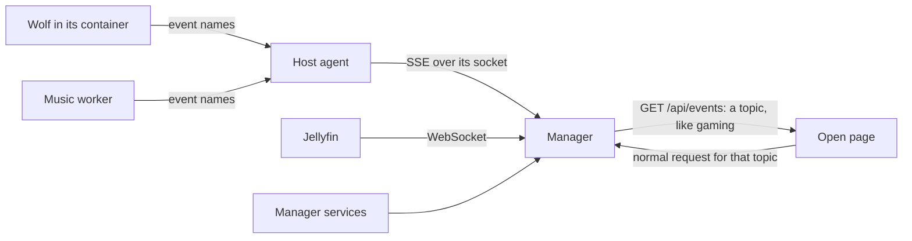

# How Iglo-OS stays light

Iglo-OS manages a home server, so it should cost that server as little as
possible. Its manager runs on one core in 512 MiB. Its host agent shares the
host with every app. This page explains what we changed to keep both light,
why, and what it gained. Most of it applies to any small self-hosted
control panel.

The numbers come from three places, and each section says which:

- **Counted** from the code, as calls per minute.
- **Measured** on a development machine or in a test.
- **Not measured yet** on the target server, an HP Elite Mini G9 with an
  i7-12700T, 32 GB and an Intel UHD 770. Those are marked as such.

## Count before you optimize

The first step was not a change. We listed every loop and poll, and counted
for each one what it costs per minute:

- calls to the Proxmox API,
- `pct` processes on the host,
- calls to an app, like Jellyfin or Immich,
- file writes,

and when it runs: always, only while a page is open, or only while something
happens. An open page multiplies by its tabs.

That list found most of the waste. An open overview made roughly 32 requests a
minute, which turned into 60 to 70 Proxmox calls (counted). Most of them asked
for the same data in the same second.

## Cost 1: the Proxmox API

**What was wrong.** The overview, the status bar on every page, the Apps view
and the background loops each asked Proxmox for `/cluster/resources`, often in
the same second. The overview also asked for each node's version every 5
seconds, though it only changes with an upgrade.

**What we did.**

- **One answer for everyone.** The Proxmox client keeps the resource list for
  2 seconds. Callers at the same moment share one request (Go's
  `singleflight`). A guest action, like a start, clears it, so the next answer
  is fresh.
- **Slow data, slow refresh.** A node's version is kept for 10 minutes.
- **Callers get a copy.** The client hands out a copy of the shared list, so
  one caller can't change what another sees. A test checks this.

**Gain.** Ten callers in the same moment make one request (measured in a
test). An open tab makes roughly half to a third of the Proxmox calls it made
before (estimated from the code).

## Cost 2: `pct` on the host

**What was wrong.** `pct` is how the agent looks into a container. Each call
starts a Perl program that loads the Proxmox modules, which costs real CPU on
the host. Several loops called it every 10 to 15 seconds:

- the gaming check, about 12 calls a minute, exactly while you play;
- the worker leases for Music and Inbox, about 16 a minute while they work;
- the Music page, about 24 a minute while it is open.

**What we did.**

- **Keep what rarely changes.** The agent keeps each container's
  `pct config` for 30 seconds. It reads that config only to check tags and
  shares, which change only during an install.
- **Don't resend what still holds.** A worker lease lasts a minute. It used to
  be resent every 15 seconds; now it goes out once less than 40 seconds are
  left, about every 30 seconds.
- **Listen instead of asking.** Where the software inside the container can
  push, the agent keeps one `pct exec curl -N` open and passes the events on.
  See the next section.

**Gain.** Half the `pct` calls of the worker leases, and for gaming, one
long-lived process instead of 12 new ones a minute (counted).

## Signals instead of timed checks

A timed check is a trade: check often and waste work, or check rarely and react
late. Where the other side can say "something changed", listening is better
on both counts.

### What can push, and what can't

| Source | Pushes? | What we do |
| --- | --- | --- |
| Wolf (game streaming) | Yes, `/api/v1/events` | The agent relays session events |
| Our Music worker | Yes, we added `/events` | The agent relays queue changes |
| Jellyfin | Yes, a WebSocket | The manager listens for playback start and stop |
| Installs by the agent | The agent knows | Its event stream says when an install moves on |
| The manager's own services | They know | They publish what changed |
| Proxmox resources, CPU, memory | No | Keep polling, shared for 2 seconds |
| Immich job queues | Not as far as we know | Keep the controller's check of 15 to 60 seconds |

### How an event travels



The design choices, and why:

- **An event names a topic, never data.** The page then asks for that topic
  the normal way. There is no second copy of the data to keep right, and a
  missed event costs only a refresh.
- **Names only, from upstream too.** Wolf's session events carry the AES keys
  of the stream. The agent passes on only the event name, so the keys never
  leave the host.
- **Server-Sent Events, not WebSockets, for pages.** The data only flows one
  way, and the browser's `EventSource` reconnects by itself. Actions stay
  normal requests.
- **Every stream has a fallback poll.** Streams drop. While a stream is up, its
  page polls about once a minute; while it is down, as fast as before.
- **A burst becomes one refresh.** The page waits 200 ms after an event before
  it refreshes, so the lines of an install refresh the Apps view once each
  second, not dozens of times.
- **A reconnect refreshes everything.** Events may have been lost while the
  stream was down.
- **The user's action wakes the watcher.** After Play, the gaming watcher
  checks every 2 seconds for a while, instead of waiting out its idle interval.
- **No process stays behind.** A relayed stream ends after 10 minutes and opens
  again, so a `curl` that lost its `pct exec` can't linger in the container.

### Gain

Measured on the development mock, which checks for changes once a second
where the real system pushes, so the real times should be shorter:

| What | Before | After |
| --- | --- | --- |
| A game session shows after Play | up to 30 s | 0.1 s |
| A second device's session is stopped | up to 10 s | 1.1 s |
| A new Music job shows | next poll, 5 to 30 s | 0.6 s |
| An install's result shows | up to 10 s | at once |
| An install's log reaches the page | a poll every 2 s | each new line, at most once a second |

The second line matters beyond speed. Every screen shares the same game saves,
so stopping the second session at once closes the window in which two
emulators could write them.

### A trap: the first look must come first

An event stream that compares "before" and "now" must take its first look
before it tells the client it is open. We had it the other way round. A change
that came right after the client saw the stream open could land before the
first look, and was never reported. CI caught it in a test, on a faster
machine than ours.

## Cost 3: what the pages load

**What was wrong.** The web app was served uncompressed, and the chart library
sat in the chunk that every logged-in page loads.

**What we did.**

- **Compress once.** The manager gzips each file on its first request and keeps
  the result, so its one core never compresses the same file twice. Each file
  gets an ETag, so a reload gets a 304.
- **Load heavy code when needed.** The usage charts load with the first chart.

**Gain (measured).** The main script went from 389 KB to 122 KB over the
wire. The chunk every page loads went from 380 KB to 25 KB. This matters most
over Tailscale and on a phone.

## Cost 4: work that waits for nothing

- **The Apps view** made 15 or more calls one after another. Now each app is
  checked at the same time, and container notes, addresses and storages are
  kept for a minute or more, until an operation changes them.
- **The Jellyfin dashboard** asked five things every 10 seconds, including the
  library counts, which cost Jellyfin real work on a large library. Now only
  "now playing" is asked each time. The rest is kept for 5 minutes, or until
  the WebSocket reports a library change.
- **The backup state** was written to disk every 5 minutes, 288 times a day.
  Now it is written only when a new backup finished.
- **Polls slow down when nothing runs.** Music and Gaming poll fast only while
  jobs or sessions run.

## Memory

32 GB is the limit of the target server, and adding RAM is not part of the
plan. So the work went into using memory well and protecting it.

### Limits are not reservations

A container's memory and cores are caps. An idle Jellyfin with a 3 GB limit
uses far less. That has two sides:

- **Cores are free to raise.** Jellyfin and the media stack went from 2 to 4
  cores, which costs nothing while idle and helps when the CPU has to step in.
- **Memory caps add up on paper.** All apps and the manager at their limits
  come to about 18.5 GiB, and 24.5 GiB while you play. The setup's review shows
  that total against the host's RAM, and warns when the peak doesn't fit.

### Decide on real pressure

Background work holds heavy jobs, like photo analysis, when memory runs low. It
used to read what Proxmox counts as used, which includes caches the kernel
would give back. Now the agent reads two things from the host kernel:

- **`MemAvailable`**: what new work can get without swapping, page cache
  included.
- **Memory pressure (PSI)**: the share of the last 10 seconds in which tasks
  waited for memory, from `/proc/pressure/memory`.

New heavy work waits when available memory drops below the headroom, or when
tasks wait more than 10% of the time. The first catches "almost full", the
second catches "struggling". On another node it falls back to Proxmox.

### Guards

- **The manager** runs with `GOMEMLIMIT=360MiB` in its 512 MiB container. Past
  that soft limit, Go collects garbage harder instead of growing until the
  kernel kills it.
- **The agent** runs with `GOMEMLIMIT=128MiB`, `MemoryHigh=512M` and
  `MemoryMax=1G`. Installs run in their own systemd units, so the caps don't
  touch them.
- **FlareSolverr**, which runs a browser for some indexers, is capped at 1 GB,
  and can be left out entirely. It is then a Docker Compose profile that
  doesn't start.

### On the host

- **Ext4 instead of ZFS.** ZFS's read cache can take a large share of RAM, and
  as far as we know Proxmox counts it as used. With one NVMe, ZFS adds little.
  On a host with ZFS and no cap, the installer prints how to set one, at an
  eighth of the RAM and at most 4 GB.
- **Compressed swap in RAM, as a safety net.** `install.sh --zram` adds zram
  with zstd, up to a quarter of the RAM, before any swap on disk. It is not a
  reason to plan for more than the RAM; it only softens a peak.

## The GPU takes over

The UHD 770 decodes and encodes video and runs machine learning. Before, only
Jellyfin used it, for two codecs. Each change below works without a GPU too.

- **Jellyfin** turns on every codec that `vainfo` reports, instead of only
  H.264 and HEVC. On a UHD 770 that adds AV1, VP9 and 10-bit HEVC, plus HDR
  tone mapping on the GPU. Reading `vainfo` instead of assuming keeps it right
  on older GPUs.
- **Immich** gets the render node and the OpenVINO image, so face detection and
  smart search run on the GPU. Video conversion uses Quick Sync after one
  switch in Immich.
- **FileFlows** gets the render node for its conversions.
- **Optional, not assumed.** The GPU settings sit in a separate compose file
  that loads only when the host has a render node.

None of this is measured on the target hardware yet.

## Power at idle

A home server idles most of the day, so its idle power is most of its bill.

**What was wrong.** The Proxmox kernel starts every CPU on the `performance`
governor (`CONFIG_CPU_FREQ_DEFAULT_GOV_PERFORMANCE` in proxmox/pve-kernel).
With `intel_pstate` and HWP, as on the i7-12700T, that sets the lowest speed
to the highest and the energy preference to 0, the most power hungry
(`intel_pstate_hwp_set`, Linux v7.0). Idle cores still sleep, but every bit of
work runs at full speed and voltage.

**What we did.** The installer adds `iglo-power.service`. At boot it sets the
`powersave` governor with the energy preference `balance_performance`. With
`intel_pstate` and `amd-pstate-epp` in active mode, `powersave` lets the CPU
pick its own speed and still boosts under load. With other drivers, like
`acpi-cpufreq`, `powersave` would pin the lowest speed, so the service leaves
them alone. Checked on 28 October 2026.

Check it on the host:

```sh
cd /sys/devices/system/cpu/cpufreq/policy0
cat scaling_driver scaling_governor energy_performance_preference
systemctl status iglo-power
```

- **To save more**, run `systemctl edit iglo-power`, add `[Service]` and
  `Environment=IGLO_EPP=balance_power`, then `systemctl restart iglo-power`.
  Game streaming and emulators may feel it first.
- **To turn it off**, run `systemctl disable --now iglo-power` and reboot. An
  update of Iglo-OS keeps it off.

**What Iglo-OS can't set.** The deepest idle states of the whole chip, package
C8 and lower, need every device to allow them. That comes from the BIOS: CPU
C-states and PCIe power management (ASPM). `powertop` shows the result in its
Idle stats tab, as the time the package spends in each C-state.

We don't run `powertop --auto-tune`. It changes every device at once, also USB
autosuspend, which can make USB adapters and controllers drop out. Try its
suggestions one at a time in its Tunables tab instead.

Not measured yet on the target hardware.

## What we tried and didn't do

- **Bun instead of Node for the build.** Measured: installs went from 4.6 s to
  0.5 s, but the type check, lint and build took just as long, because they
  run the same tools. Nothing of Node runs on the server, so it gains nothing
  there.
- **TypeScript 7.** Measured: the type check went from 3.3 s to 0.7 s. But the
  linter's TypeScript plugin supports only up to 6.0, and Bun 1.3 broke the
  side-by-side install that Microsoft recommends. Not worth it yet.
- **Merging the Docker stacks into one container.** It would save the memory
  of a few Docker daemons, 300 to 500 MB, but lose the isolation between apps.
- **Leases through a bind mount instead of `pct exec`.** Halving the calls took
  most of the gain, for a much smaller change.

## Lessons that apply elsewhere

- **Count first.** A list of what each loop costs per minute found more than
  any profiler would have, because the waste was repetition, not slow code.
- **Share before you cache.** One answer for everyone in the same second beats
  a cache per caller.
- **Push when you can, poll as the fallback.** Never only push.
- **Send names, not data.** It keeps the stream simple and keeps secrets out.
- **Use the hardware that is there.** The GPU was idle while the CPU did video
  and machine learning.
- **Decide on what the kernel sees.** `MemAvailable` and pressure say more than
  "used".
- **Check upstream at the version you run.** Several APIs worked differently
  than remembered. The code comments name the version each one was checked
  against.
- **Test on a stand-in, and say what it isn't.** The development mock found
  most real bugs, but its timings are only an upper bound.

## Status and command output follow-up

Checked on 28 October 2026. Health, Updates and Backups now publish their
own live topics from the manager, also when running against the dev mock.
With the stream connected, an idle Health or Updates page makes one fallback
request per minute instead of four. Backups makes one instead of two. With a dropped stream, active
updates poll every 2 seconds and backups every 3 seconds for progress.
These are counted requests per open page, not hardware measurements.

Storage and backup archive lists are shared for one minute. Ten concurrent
Backups reads on a node with two backup storages make one storage-list call
and two archive-list calls, rather than ten and twenty (tested). Independent
nodes and storages are read in parallel. Incomplete results are not cached.
An operation, a changed backup job or a newly observed scheduled backup task
invalidates the inventory. In-flight old reads cannot repopulate it after
invalidation. Destructive actions still look up their archive afresh. The
existing resource cache remains in the Proxmox client.

Update jobs and host restores retain only the last 256 KiB of command output
while the command runs. Update result lines are parsed before old log text
is discarded, with bounded line length and result count. A verbose command
cannot grow the complete output in memory before truncation. Tests exercise
a 1 MiB command and retain a package result from before the visible log tail.

Notification delivery runs outside request and operation handlers. A slow
provider does not hold the queue's state lock or delay another alert being
saved. Each delivery pass has a 20-second deadline. The worker sleeps until a
pending retry deadline; an empty queue has no timer. New alerts wake it at
once.

### Signal follow-up

Health, Updates and Backups use one-minute fallback reads while SSE is live,
even during an operation. Their manager services publish operation changes;
without SSE, active updates and backups retain 2-second and 3-second reads.
A connection transition immediately invalidates active topic queries so their
intervals change without waiting for an old minute-long timer. The first
connection also refreshes snapshots. Event bursts are throttled to one flush
per 200 ms, so a continuous burst cannot postpone a refresh indefinitely.

The notification worker now arms a timer only for the earliest pending retry.
New alerts wake it immediately. An empty queue causes zero periodic wakeups.
